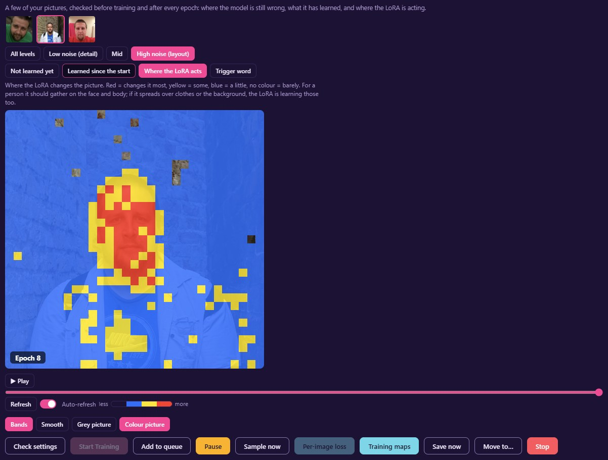
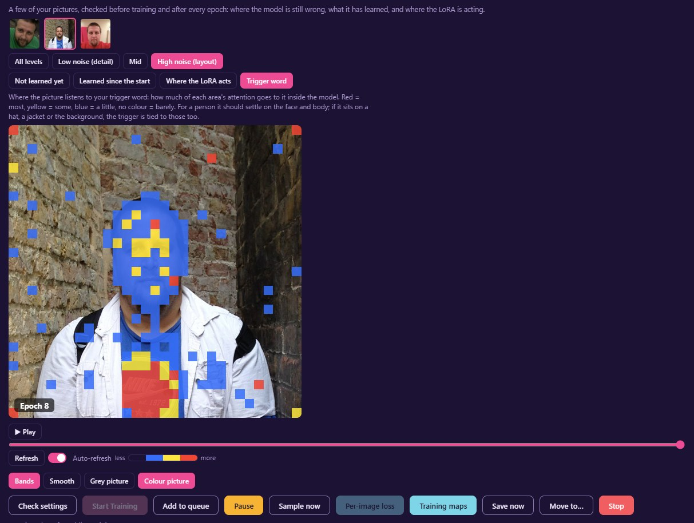

# Fizgig v9.3.0: Training maps, a much faster compile warm-up, and fine-tunes with the optimizer you pick

**New: Training maps.** See what training is doing to your pictures, epoch by epoch. Tick **Training maps** under Training Parameters, and three of your training pictures are checked before training and after every epoch, for a few seconds an epoch. The **Training maps** button on the run card shows each one with a heatmap over it:
- **Learned since the start:** green where the model now gets that part of the picture right, magenta where it got worse.
- **Not learned yet:** where the model still can't reproduce your picture.
- **Where the LoRA acts:** where the LoRA changes the picture. For a person it should gather on the face and body; spreading over clothes or the background means it's learning those too.
- **Trigger word** (MOSS-Image, Krea 2 and Qwen Image 2.1, an experiment): how much of each area's attention goes to your trigger word inside the model.

Above, a person LoRA about ten epochs in. **Where the LoRA acts** is strongest on the face. The **Trigger word** map sits on the face, and also on the logo on the T-shirt: a made-up trigger word looks to the model like a word it might write, so it's drawn to lettering. If it stays there, the trigger is being tied to the logo.

Each comes at three noise levels or all together, with play, scrub, a full-window view, a Map opacity slider and auto-refresh while the run trains. It works on every still-picture model. [Training maps guide](https://github.com/shootthesound/Fizgig/blob/master/docs/TRAINING_MAPS.md)

**Compiled runs warm up much faster.** The compiler now builds each block for any picture size and caption length from the start, instead of rebuilding for each new one it meets. Runs using **Leave the rest of the model alone** or **Fizgig LoRA Isolation** gained most: on MOSS-Image with 25 picture sizes, the first steps went from about 19 s each, with 81 rebuilds in the first 26 steps, to a whole 2-epoch test in 84 s with 4. Runs without it reach full speed sooner too (epoch 1 at 0.38 s a step instead of 0.68). Speed once warmed up and memory are unchanged. On Krea 2, compiled blocks also stop rebuilding for each caption's length: the same kind of run reached full speed (0.93 s a step) within its first epoch, where its first 27 steps had taken 3 minutes.

**Full fine-tunes train with the optimizer you pick.** A fine-tune always trained with Adafactor while the Training tab showed the model's LoRA optimizer, Muon. Picking Fine-tune now sets **Adafactor**, back in the Optimizer Type list and the recommended choice. AdamW8bit, AdamW, AdEMAMix8bit and Lion8bit work too, and the memory planner makes room for their larger state. Muon, Prodigy and Automagic are LoRA optimizers: a note under the row says so if one is picked for a fine-tune, and the run uses Adafactor. With "Free each gradient as soon as it's used" on, the progress bar now shows the learning rate. Thanks to @RitschRatsch666 (#312).

**Also**
- **The per-image loss watch throttles less.** A picture is only marked stuck when it's a real outlier, not just among the hardest third, and a stuck picture's learning rate now stops at ×0.25 instead of ×0.1. Replaying 39 real runs, the old rule had held back about a third of every dataset late in a run.
- **Each tab keeps its scroll place,** so going back to Training from Samples puts the loss chart where you left it.
- **Studio with seed 0** renders on a fresh random seed when you press Update or Start. Moving a slider keeps the same seed, so a tweak is judged on the same picture.
- **✨ MOSS-Image Turbo Train** trains at rank 32, alpha 16.
- **Steps waste less time on a busy CPU:** the step's loss is read one step later, so the CPU no longer waits for the GPU at the end of every step.

**Updating:** run the updater as usual. Pods you use from your own Fizgig follow your computer's version when they're free.
