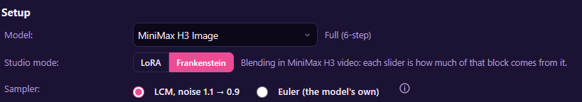

# Fizgig v9.8.3: Frankenstein mode - MiniMax H3 video's motion in H3 Image's stills

**Frankenstein mode in Studio blends two base models block by block: MiniMax H3 Image with MiniMax H3 video.** Many people prefer H3 video for stills because it understands motion; H3 Image is cleaner but renders action frozen and pin-sharp. Choose MiniMax H3 Image in Studio, set **Studio mode** to **Frankenstein** and press Start: each block slider becomes how much of that block comes from H3 video (0 = H3 Image as it is, 1 = all H3 video). Baseline is H3 Image on its own, Tweaked the blend. No LoRA is involved: it works on the two models themselves, and uses the H3 video file and H3's Turbo LoRA set in Preferences.

**Start from ✨Motion.** We swept every block across five motion scenes at 2560 × 2560 (a tennis ball through a window, a car drifting into crates, a wine glass knocked over, a skateboarder grinding a rail, a horse through a river). The motion lives in about blocks 26-36: **✨Motion** (H3 video's blocks 27-28 and 32-34 at 0.65) brings back motion blur on fast things, spray, smoke and a curtain whipping in while keeping H3 Image's look, and **✨Motion, gentle** (28-34 at 0.6) is the lighter one. Blending a lot at once breaks the picture, worst into the last blocks (38-49), so 🎲 I'm feeling lucky rolls from 0 to 0.6 in this mode (raise the limits to go further).

**Save blend as a new base** writes the blend as a new H3 Image file (about 21 GB, int8, the original's own format) that ComfyUI and Fizgig load like the original, with the mix recorded in its metadata.

**What it needs: a 16 GB card or bigger, with 48 GB of system RAM (64 GB with a 16 GB card).** The mode always loads H3 Image at int8 and, with block swap on Auto, streams just enough blocks from system RAM for your card: none on a 32 GB card, 11 on a 24 GB card, 32 on a 16 GB card, all measured rendering ✨Motion at 2048 and 2560 and saving a new base. A streamed block blends in system RAM and renders exactly as one on the card; renders on a smaller card take longer. The [Studio guide](https://github.com/shootthesound/Fizgig/blob/master/docs/STUDIO.md#frankenstein-mode-minimax-h3-image) has the full figures.

**To update:** run the updater as usual.
