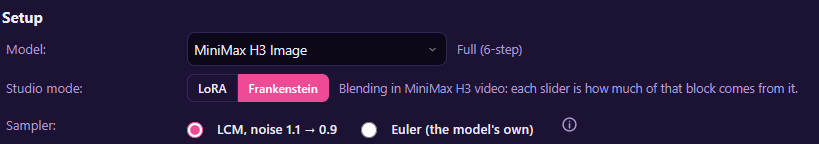
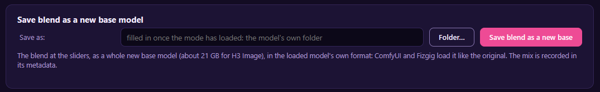

# Studio

Studio changes a finished LoRA block by block and shows the result live: a **Baseline** render (the LoRA as it is) beside a **Tweaked** render (with your slider changes), same prompt and seed, so the only difference is the sliders. When it looks right, **Save repaired LoRA** writes a new file that renders exactly like the Tweaked preview. The original is never changed.

Use it to:

- **Fix a LoRA instead of retraining it.** A LoRA that overbakes skin, fights the prompt or drags in its training backgrounds can often be rescued by turning one group of blocks down.
- **Keep part of a LoRA.** Turn off everything but the identity blocks, or everything but the style blocks.
- **Mix LoRAs** block by block: identity from one, style from another, or several LoRAs at their own amounts.
- **Explore**: 🎲 I'm feeling lucky rolls random block strengths within limits you set.
- **Blend two base models** (MiniMax H3 Image with H3 video): [Frankenstein mode](#frankenstein-mode-minimax-h3-image) puts H3 video's sense of motion into H3 Image's stills and saves the blend as a new base model.

Every image and video model has Studio; ACE-Step (songs) has it too, with a song player in place of the pictures.

## Getting started

1. **Model**: the model the LoRA was trained for.
2. **Preview with**: where the model has one, the fast few-step preview model (Turbo / Distilled) or the full model. The fast one is right for slider work; check a final result on the full model.
3. **Primary LoRA**: Choose… the file. **at strength**: the strength you normally use it at (not always 1.0). The sliders work relative to it, and the saved file keeps that scale, so used at this strength it looks exactly like the preview.
4. **Prompt**, **Seed** (↻ for a random one) and **Width / Height** (clips: length, size and steps; songs: length).
5. **Start**. The model loads on the Fizgig machine (the first time takes a minute) and renders the pair. After that every slider change re-renders Tweaked by itself. **Unload model** frees the GPU; leaving the tab does too.

Click either picture to see both full size (← → switches between them). There, scroll to zoom in where the cursor is, up to 4× the picture's own pixels, drag to move around, and double-click to jump between fit and 1:1 pixels; ← → keeps the zoom and place, so Baseline and Tweaked compare on the same detail. The same view opens from the Samples gallery and the Captions tab. **⧉ Keep in view** puts the pair in a panel that stays on screen while you scroll down to the sliders.

**Reuse unchanged blocks** (on by default where the model has it) keeps the unchanged blocks' results in VRAM and replays them, so a change to a late block renders almost at once. It is the same picture as a full render. Turn it off if VRAM is tight.

Studio can't load while a training run is using the GPU.

## The block sliders

One row per block of the model, grouped as the model is built, and colour-coded by what the Profiler found blocks of that kind do. A greyed row is a block this LoRA doesn't train: moving it would change nothing.

On each row:

- **The tick** turns the block on or off.
- **The slider** sets its strength, from -3 to 3. 1.0 is the block as trained, 0.5 half of it, 0 nothing, a negative value inverts it.
- **The value box** shows the strength. Click it and type a number to set it exactly (Enter sets it, Esc puts it back).
- **0 / 1** set it to 0 or 1, **±** flips the sign, **− / +** step 0.1.
- **🔒** locks the row: presets, bulk buttons and lucky rolls leave it alone.

**↶ Undo / ↷ Redo** (Ctrl+Z / Ctrl+Y) step back and forward through your changes.

Above the rows:

- **Presets**: the model's built-in ones (✨) and yours. **Save preset…** keeps the current sliders under a name for this model.
- **Primary + donor, 50/50** (with a donor loaded, on every model): each block both LoRAs touch gets each at 0.5, and a block only one of them touches gets that one at full strength. Locked rows are left alone.
- **Bulk buttons**: Reset all, All off, All on, Invert, Alternate (even blocks on, odd off), and, where the model has them, Toggle detail blocks.
- **Master controls** (models with a block map, such as Klein): one slider per category (Style + Composition, Identity, Details) that moves all its blocks together, on the primary or the donor.

## A donor LoRA

**Donor LoRA** loads a second LoRA on top. Every block row then gets a second slider, for the donor's block, so you choose block by block how much of each LoRA you get. **⇄** on a row balances it: the other side gets 1 minus this one. Donor: all on / all off and the masters' **Masters affect: Donor** work on the donor's side.

Saving a mix is exact: where both LoRAs are on, the saved file holds both side by side (its rank is the two ranks added), so it renders just like the preview.

## Mixing epochs and LoRAs

**Mix** on the primary's row:

- **Epochs of this run**: the saved epochs beside the primary, blended as a moving average. **Up to** is the newest epoch in the blend, **History** how much of the earlier ones comes with it (0 = that epoch alone). Often smoother than any single epoch.
- **LoRA mix**: the primary plus other LoRAs for this model, each at its own amount (for example, one style at 1.0 and another at 0.5).

The donor has its own **Blend the donor's epochs**. The block sliders shape the whole mix, and Save bakes it into one LoRA.

## 🎲 I'm feeling lucky

Each roll gives the chosen number of sliders (**Roll**: 1, 2, 4 … or All) a random strength between the two limits beside it. **Hold structure + tidy-up** keeps the blocks that hold the picture together near 1, so rolls stay usable; untick it to roll every block across the whole range. With a donor you choose which LoRA a roll changes.

When a roll gives you something you like in part, **🔒 Freeze tweaked** locks every block you've moved, so the next rolls only change the rest. **🔓 Unfreeze** lets them go again (blocks you locked yourself stay locked).

## Reading the result

- **The numbers under the pair** compare the two renders: likeness to a reference photo (📷 Reference…, for a person LoRA), Grid (the model's patch lattice showing through: rising means overbake), Detail (texture in the face, or the whole picture: down is plastic, up is fried), Clipped (blown pixels) and Sat (saturation). They're a guide; trust your eye.
- **Profile found for this LoRA**: when the Profiler has profiled this exact file, its findings show here, with a link to the full report.
- **Model EQ Mode** (models with a Model EQ LoRA set in Preferences): a row holds the model's own weights instead of a LoRA, so the sliders turn the stock model's own blocks up or down. Press it again to get your LoRA back.

## Maps

Under the preview, **Maps** draws a heatmap over the Tweaked picture, for any LoRA Studio can load (one you didn't train included). It's the [training maps](TRAINING_MAPS.md)' method: the picture is noised at three levels and the model's prediction compared. Pick a map and it appears after a few seconds (a badge on the picture says while it's being made); it's made again after every render.

- **Where the LoRA acts:** the LoRA as you've set it, against no LoRA. For a person LoRA it should gather on the face and body; spread over clothes or the background, the LoRA changes those too.
- **What your tweaks change:** move any slider and let the picture render: where your change acts, against the Baseline. With nothing moved there's nothing to show, and nothing is calculated.
- **Trigger word:** where the trigger word's attention goes. The word comes from the LoRA's own information, or type it and press **Show**. A made-up trigger word often lands on lettering in the picture (a sign, a logo) as well as the subject. Every picture model but SDXL.
- **Blocks:** where each group of the LoRA's blocks acts (the picture as tweaked, against the same with that group off), a button per group: the model's charted areas where it has them (MOSS-Image's Identity 24–35, Klein's Style + composition, Identity and Details), else runs of about seven blocks. A group that lights up the background or clothes is the one to turn down there.

Red means most, then yellow, then blue; no colour, barely. Each map is scaled from the picture's quietest area up, so what shows is where it acts most. **All levels** or one noise level, and **Opacity**, are under the buttons. Picture models only.

## Saving

- **Save repaired LoRA**: name the new file under **Save as** (**Folder…** picks where it goes, keeping the name) and press it. It's a normal LoRA for ComfyUI and anything else, with the slider settings recorded in its metadata.
- **No LoRA: Studio as a generator.** Leave the primary box empty and press Start: the base model renders on its own, any model, in one pane, with every setting, Save, Save every render and the queue as usual (saved files say `base` where the LoRA name goes). The block sliders, masters and Save repaired LoRA grey out with a line saying they need a LoRA, and Measures and Maps step aside. A donor with no primary still compares: Baseline is the base model, Tweaked the base model with the donor. **Unload primary** (beside its Choose…) takes the primary out without reloading the model, as Unload donor does for the donor. Choosing another primary and pressing Render swaps it on the loaded model too, in a second or so (not on MiniMax H3 video or in Frankenstein mode, which load again).
- **◀ ▶ between the panes**: ◀ hides the Baseline so Tweaked takes the whole width, ▶ hides Tweaked so the Baseline does; the one arrow left at that edge brings the other back. **A hidden pane isn't rendered** (for an H3 clip, half the time), for every model; this replaced H3's Tweaked only tick. With Tweaked hidden, slider moves render nothing (they only change Tweaked). A pane brought back that wasn't rendered says so until you press Render, which fills it. Measures (they compare the two) hide while one pane is hidden; Save original / Save tweaked, Continue, Loop back, Upscale and Use as source need their pane rendered. Queue jobs render the panes showing when they were queued. Studio opens with both panes each time (a hidden pane isn't remembered); with no LoRA it shows its one render in the Tweaked pane, whichever was hidden. A hidden pane stops playing, and Play together plays only what's on screen. A phone shows both stacked.
- **💾 Save original / Save tweaked**: the two renders straight into the **Studio outputs** folder (Preferences > Other folders; `Studio_Outputs` inside Fizgig unless you change it): pictures in `images`, clips in `videos`, songs in `songs`. No Save window. Each file is named `<model>_<LoRA>_<original|tweaked>_seed<seed>_<date-time>`, so nothing is overwritten; a render already saved says so instead of saving again. On a pod, a phone or another computer the file is saved there and also downloaded to the device you're using. A saved Tweaked picture keeps Studio's settings inside it (the LoRAs, every slider, the prompt and seed): **drop it on the Studio tab to get them all back**.
- **Save every render** (beside the Save buttons under the preview, off unless ticked, kept for each model): every finished render is saved there by itself: the Tweaked one each time, and the Baseline when it rendered again (not when only the Tweaked one changed). With nothing moved the two are one render, saved once.
- **Add to queue** (beside Render; greyed while nothing renders and no jobs wait, when Render is the button to press): lines up the render exactly as Studio is set now (model, LoRAs, sliders, prompt, seed, size, a clip's settings) in **Studio's own queue**, separate from the training queue. Jobs render one after another, each loading its model or LoRA first when it differs, and each is saved into the Studio outputs folder as it finishes. A seed of 0 gives each job its own random seed. The **Studio queue** bar sits between Setup and Preview all the time, one slim line until you click it open (click its head again to close it). It lists the jobs (move them up or down, remove them) and keeps finished ones with links that open their saved files, until **Clear finished**; a failed job is marked and the next runs.
  - **One render at a time.** While a model loads or a render is going, Render is greyed: **Add to queue** lines the next one up, and **↻** (new seed) adds a job with the new seed instead of cutting the render short. Continue, Loop back and Upscale work on the clip in the Tweaked pane, so they wait for the render going now; a queued clip job upscales only by Upscale's Auto tick.
  - **It pauses, and only you resume it.** Leaving the Studio tab, starting a training run, or restarting Fizgig pauses it; the job rendering at that moment finishes first. Coming back to Studio asks whether to resume. Closing the browser doesn't pause it, so a queue can run overnight.
  - **It waits** while a training run, a caption job or the Profiler has the GPU.
  - Moving a slider while a job renders doesn't cut the job short: your render follows it, and always on your own LoRA. When the job had another model or LoRA loaded, Studio loads yours again first (the next job waits for that), so nothing of yours is ever rendered or saved on a job's LoRA.
- **Save setup**: everything on the tab (the LoRAs, every slider and tick, the prompt, seed, size, photos and source) in one named file. **Load a setup…** restores it exactly, switching model if it needs to, loading its LoRAs and rendering.

## Frankenstein mode (MiniMax H3 Image)

Frankenstein mode blends two base models block by block: H3 Image with MiniMax H3 video. Many people prefer H3 video for stills because it understands motion and time; H3 Image is cleaner but renders action frozen and pin-sharp. Blending some of H3 video's blocks into H3 Image brings the motion back (motion blur on fast things, spray, smoke, a curtain whipping in) while keeping H3 Image's look. No LoRA is involved: it works on the two models themselves. **It's an experimentation tool**, here for now to explore what mixes of the two models can do; it may not stay in Fizgig for good. ✨Motion is a good start; there's plenty more to find, and finds are welcome.

1. Choose **MiniMax H3 Image** as the model, set **Studio mode** (under it) to **Frankenstein**, and press **Start**. It uses the H3 video file and H3's Turbo LoRA set in Preferences (the Turbo LoRA goes into H3 video's side, so its blocks work at H3 Image's few steps; Start asks for either file if it's missing). The Primary and donor rows step aside.
2. **Each block slider is now a blend**: how much of that block comes from H3 video, from 0 (H3 Image as it is) to 1 (all H3 video). They start at 0. **Baseline** is H3 Image on its own; **Tweaked** is the blend, rendered as a normal base model.
3. **🎲 I'm feeling lucky** rolls blends from 0 to 0.6 in this mode, where big blends rarely break the picture; change the two limits to roll higher (up to 1).
4. **Presets** in this mode: **✨Motion** (blocks 27-28 and 32-34 at 0.65), **✨Motion, gentle** (28-34 at 0.6) and **✨Reset All** (everything back to 0). Your own presets for this mode are saved separately from your LoRA presets.
5. **Save blend as a new base** (its own card beside Save) writes the blend as a new H3 Image file (about 21 GB, int8, the same format as the original) under **Save as** (**Folder…** picks where it goes), `<H3 Image file>_frankenstein.safetensors` unless you change it. ComfyUI and Fizgig load it like the original. The mix is recorded in the file's metadata. It renders the blend's look; fine details can differ slightly, as they do for any small change on this model.

   

What we found, sweeping every block at 2560 × 2560 across five motion scenes (a tennis ball through a window, a car drifting into crates, a wine glass knocked over, a skateboarder grinding a rail, a horse through a river):

- The motion lives in about **blocks 26-36**, strongest around 28-34. 0.5-0.75 keeps H3 Image clean; the presets are the best of the sweep.
- **Early blocks (0-10)** change the composition (camera, room, framing) more than the motion.
- **What breaks the picture is blending a lot at once**, worst when it reaches the last blocks (38-49). Blocks 20-49 or 30-49 dissolve into grain and smear at 0.75 and are destroyed at 1.0; 20-40 turns grainy at 0.75 and breaks at 1.0; 30-40 is fine at 0.75 but messy at 1.0; every block at once holds up to 0.75 and degrades at 1.0.
- **No small group of blocks broke it on its own**: every run of 3 blocks, anywhere from 0 to 49, stayed a clean picture even at 1.0 (sometimes grainier than at 0.75), and a few late blocks together with others (20-22 and 38-40 at 0.75) were fine. Keep blends to a few blocks at 0.5-0.75.

**What it needs: a 16 GB card or bigger, and system RAM to match.** The mode always loads H3 Image at int8 (the blend works on the int8 weights). With Preferences' inference block swap on Auto it streams just enough blocks from system RAM for a render up to 2560 × 2560 on your card; a streamed block blends in system RAM and renders exactly as one on the card. Measured on an RTX 5090, also set to act as a 24 GB and a 16 GB Windows card:

| Card | Blocks streamed | System RAM, Fizgig's Studio process at its peak | ✨Motion at 2048 and 2560, every block at 1.0, Save blend |
|---|---|---|---|
| 32 GB (RTX 5090 class) | none | 31 GB | yes; renders at 2560 in about 16 s |
| 24 GB | 11 | 36 GB | yes |
| 16 GB | 32 | 46 GB | yes |

So plan on **48 GB of system RAM with a 32 GB or 24 GB card, and 64 GB with a 16 GB card**: the streamed blocks wait in RAM (about 0.4 GB each), and the first render loads the text encoder (Qwen3-VL-32B), the biggest moment for RAM on every card. Renders on a smaller card take longer, as streamed blocks do. Saving a new base needs 21 GB of free disk.

On the 32 GB card, card memory at each step (PyTorch's own figure; the driver keeps about 0.5-1 GB more):

| | Card memory | System RAM |
|---|---|---|
| H3 Image loaded | 19.9 GB | 3 GB |
| First render (the text encoder loads) | 22.3 GB | 31 GB, for a moment |
| A slider change | 20.7 GB | 9 GB |
| Render at 1024 / 2048 / 2560 / 3072 | 22.3 / 22.4 / 23.5 / 24.8 GB | 9 GB |
| Every block to 1.0 at once (the biggest change) | 21.3 GB | 9 GB |
| Save blend as a new base (17 s, a 21 GB file) | 22.5 GB | 9 GB |

A block swap number you set in Preferences is kept; on Auto the mode picks its own, as above. Reuse unchanged blocks is off in this mode.

## Video (MiniMax H3)

The pair are clips with sound. **Play together** plays both in step. Clip length, size, steps and the built-in Turbo strength are on the Clip row (Turbo 1.0 with 4 steps is the fast loop; set Turbo to 0 to edit a Turbo LoRA itself). **Speed Boost** renders the first half of the steps at half size. **Show early** puts up an estimate in the Tweaked pane while the remaining steps run. **First / Last Frame** takes photos for the clip to start and end on; the Reference model takes up to two photos you name in the prompt as `<Picture 1>` / `<Picture 2>`.

## Songs (ACE-Step)

The song player plays Baseline, Tweaked or No LoRA (the base model, same seed). Prompt B blends a second prompt in (0 = A alone, 1 = B alone, with A's lyrics kept if you like). **Start from a song** follows a song's melody and timing (Follow), starts from its actual sound (Denoise), repaints only a section you drag across the waveform, or extends it. **Sound like a recording** makes the song sound like a reference recording. **⤵ Use as source** makes the Tweaked song the one to start from. **💾 Save Tweaked WAV** saves it.
