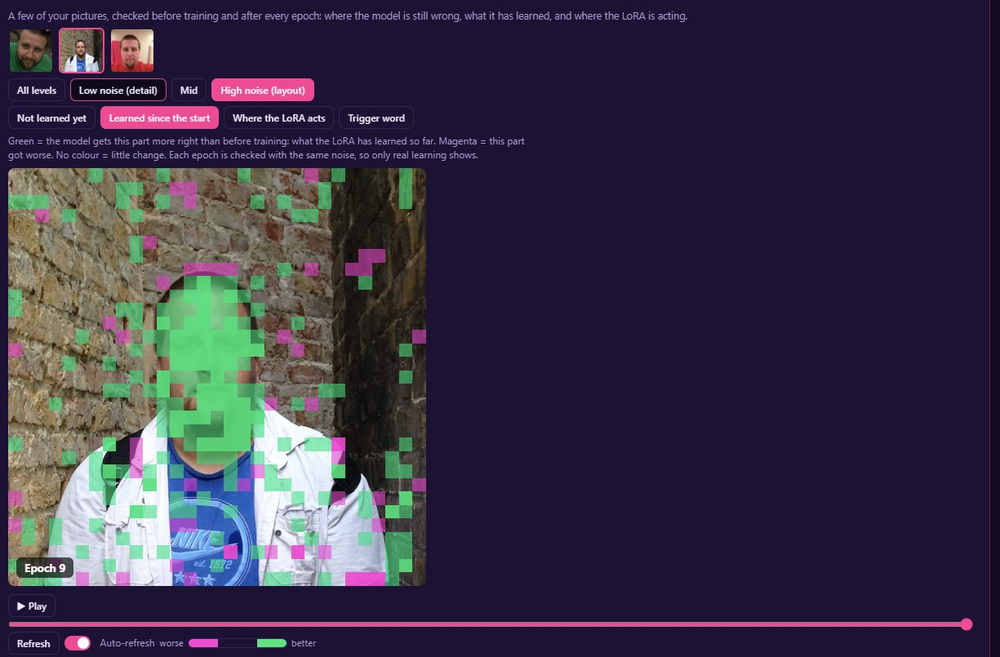
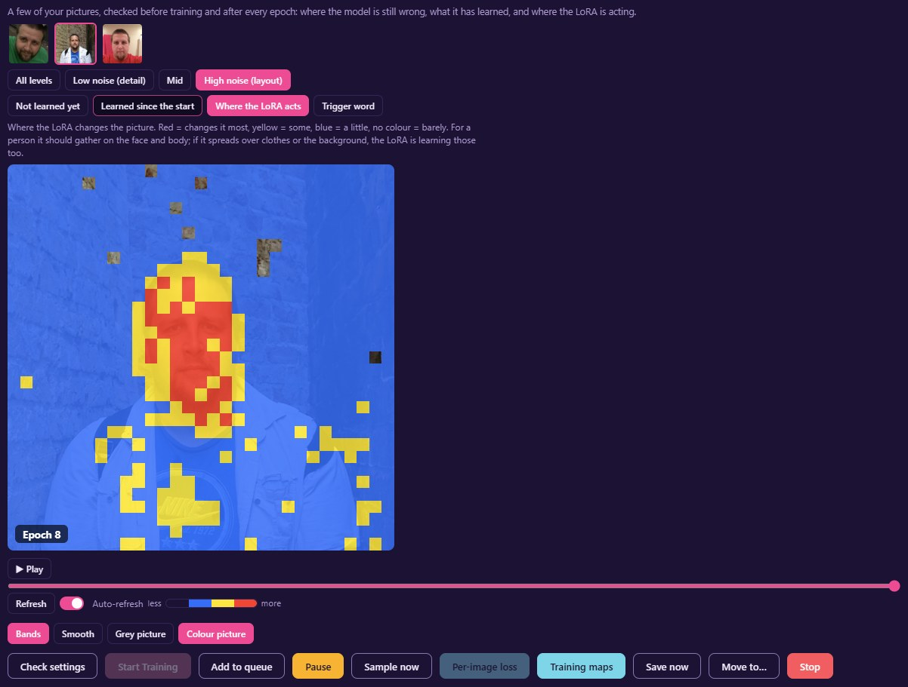
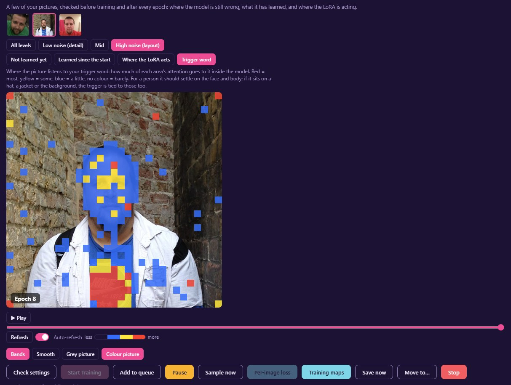
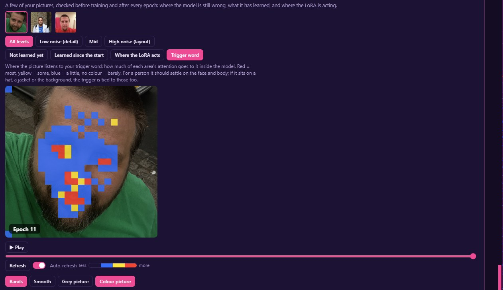
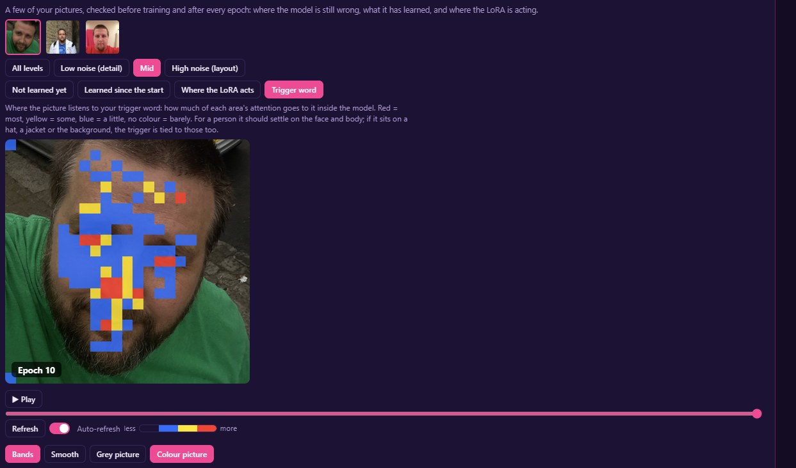
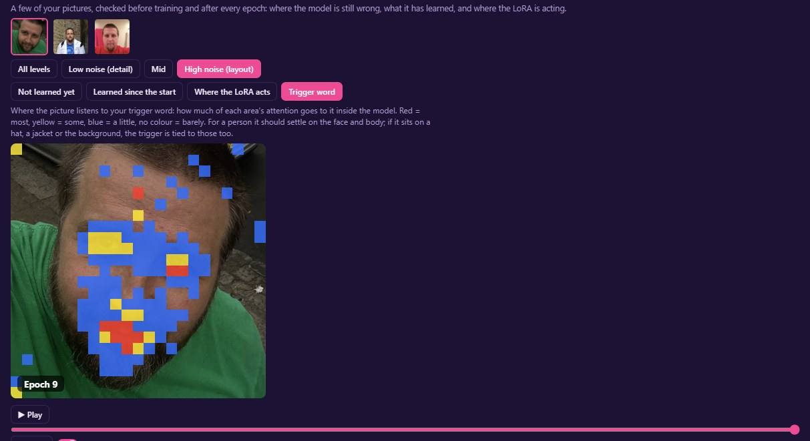

# Training maps

Training maps show what training is doing to your pictures, epoch by epoch, as heatmaps over three of your own training pictures. You can see which parts of a picture the LoRA has learned, which it hasn't yet, and where it's changing things it shouldn't.

They work on every still-picture model: Klein 9B, Flux 3 Image Klein, Fibo 2.0, Krea 2, Qwen Image 2.1, MOSS-Image, Z-Image Turbo and Base, SDXL and Anima. Clip and song models (MiniMax H3, Vimoo, ACE-Step) don't have them yet.

## Turning them on

Tick **Training maps** under Training Parameters on the Training tab, then start the run. Fizgig picks three of your training pictures (spread through the folder, so the same folder picks the same ones), checks them once before training starts and again after every epoch, and saves the results with the run. It adds a few seconds an epoch.

To open them, press **Training maps** on the run card, or beside the run in Runs & outputs. You can open them while the run trains: with **Auto-refresh** ticked (the default), each new epoch comes in as it lands.

## What each map shows

Pick a picture at the top, then a map:

- **Learned since the start.** Green where the model now gets that part of the picture more right than it did before training: what the LoRA has learned so far. Magenta where it got worse. No colour where little changed. This is the one to read first.
- **Not learned yet.** Training covers your picture in noise and asks the model to recover it. This map shows where its attempt still misses your picture: red where it misses most, then yellow, then blue, and no colour where it's nearly right. Fine detail (hair, edges, fabric) always shows warmer than smooth areas, so watch one area cool from epoch to epoch rather than comparing it with the rest of the picture.
- **Where the LoRA acts.** Where the LoRA changes the picture, on the same red / yellow / blue scale. For a person it should gather on the face and body. If it spreads over clothes or the background, the LoRA is learning those too.
- **Trigger word** (Klein 9B, Flux 3 Image Klein, Fibo 2.0, Krea 2, Qwen Image 2.1, MOSS-Image, Z-Image Turbo and Base, and Anima; not SDXL; an experiment). How much of each area's attention goes to your trigger word inside the model, on the same scale. For a person it should settle on the face and body; if it sits on a hat, a jacket or the background, the trigger word is tied to those too. It appears when the run has a trigger word and the picture's caption contains it. 

## Examples

From a person LoRA, about ten epochs in.

**Learned since the start** at high noise (the layout): green across the face, where the model now gets the person right; only scattered cells elsewhere.

**Where the LoRA acts**, the same picture: strongest (red) on the face, some (yellow) on the hair, shoulders and the T-shirt's logo, and a little (blue) over everything else.

**Trigger word**, the same picture: the trigger's attention sits on the face, and also on the logo on the T-shirt. A made-up trigger word looks to the model like a word it might be asked to write, so its attention is drawn to lettering: logos, signs, watermarks. If it stays there as training goes on, the trigger is being tied to the logo. Crop or paint the logo out, or caption it.

**Trigger word** on a close-up, at all levels together: settled on the face, the eyes and the mouth.

The same close-up at mid noise and at high noise (the layout), where it spreads a little wider:

## Several subjects

With Multi Concept or Fizgig LoRA Isolation, each subject gets at least one of the map pictures (so four subjects means four pictures). An Isolation run also includes one of each subject's side-by-side pictures: your subject beside a stranger. On the Trigger word map, the trigger should land on your subject and stay off the stranger. That's a direct look at whether Isolation is keeping other people themselves.

On a picture whose caption names more than one subject's trigger word, the Trigger word map gets a row of buttons: **All triggers**, then each trigger word on its own. Pick one and check it lands on its own person, not the other.

## Noise levels

Each picture is checked at three noise levels, always with the same noise, so only the LoRA changes from one epoch to the next:

- **All levels** (the default): the three together, each counted equally. The overall picture.
- **Low noise (detail):** fine detail, skin, texture.
- **Mid.**
- **High noise (layout):** the broad shapes and composition.

## Reading them

- Each map keeps one colour scale across all the epochs, so a colour fading really is the error falling.
- The picture is shown as it trained: cropped to its bucket, so the map sits exactly on it.
- Scrub or press **Play** to step through the epochs. Click the picture to see it full-window; the arrow keys step through the epochs, and a click or Esc closes it.
- By default the photo is shown in grey under the map, and the map in a few clear colour bands. **Smooth** and **Colour picture** switch either back, and **Map opacity** makes the map fainter or stronger (100% is the default; double-click the slider to put it back). The viewer remembers your choices.

## What to look for

- **A face that stays warm on Not learned yet while the rest cools:** likeness is coming slowly. Check the face is a decent size in the pictures before changing settings.
- **Where the LoRA acts spreading over a recurring background, jacket or prop:** the LoRA is learning that too. Vary those in the pictures, caption them, or use masked training.
- **Learned since the start turning magenta in an area after epochs of green:** the LoRA is starting to overwrite something it had right. An earlier epoch may be the better LoRA.
- **The Trigger word map sitting on something other than the subject:** the trigger word is bound to that thing. Captioning it, or varying it across the pictures, helps.

## In Studio

Studio has the same maps for any LoRA, including ones you didn't train: under its preview, **Maps** draws where the LoRA acts, what your slider changes do, where the trigger word's attention goes and where each block group acts, over the Tweaked picture. See [STUDIO.md](STUDIO.md#maps).

## Where they're saved

In the run's output folder, under `training_maps/<LoRA name>/`: `probes.json` (which pictures and noise levels) and `maps.jsonl` (one line per epoch).
