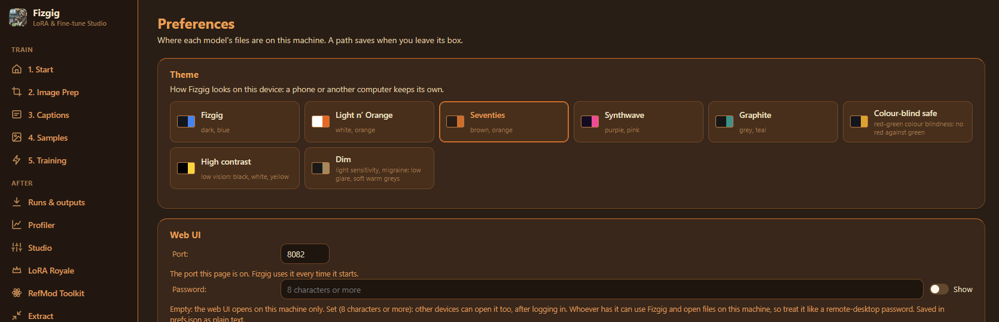

# Fizgig web UI

Fizgig is a web page: in its own app window on your computer, in your browser, on a pod, on a machine with no screen, or on your phone or another computer to set up and watch training.

## On a RunPod pod

The pod starts Fizgig by itself. In the pod's **Connect** menu, open **HTTP port 8081** and log in with the pod's password: the `FIZGIG_PASSWORD` you set in the template, or, if you didn't set one, the password printed in the pod's logs (generated on its first start and kept after that). There's no user name. On a pod from the Classic template it's the same page and the same `VNC_PASSWORD` as the remote desktop on port 6080. [The pod guide](../docker/README.md) has both.

From there everything works in the browser: download the models (Preferences), upload your training data (Start tab), train, watch the previews and download the results.

## Pods: a rented GPU from your own Fizgig

The **Pods** tab in Fizgig on your own computer opens your RunPod pods. Add a pod by pasting its ID (the code under its name on RunPod's Pods page) or its address; the address of a Fizgig on another computer on your network works too. Each pod shows whether it's ready, still starting, or stopped. **Open** takes the Fizgig window to the pod (in a browser, it opens a tab): it's the same app, running on the pod's GPU, with "You're on <pod>" and a **Switch to this computer** button at the top of the window to come back (the pod keeps running). Close the window on a pod and it opens on that pod next time, if the pod is still running.

<p align="center"></p>

With your RunPod API key (RunPod > Settings > API Keys, pasted into the tab), your Fizgig pods are listed without adding them, and **Start and open** / **Stop** work from the tab: a stopped pod starts and opens by itself once its Fizgig answers. A pod can take a few minutes to start; if it isn't ready after that, check it on RunPod (its Logs show what it's doing). The key is saved on your computer only. In the app window, your pods open already logged in. The window reads the pod's password from its settings on RunPod (`FIZGIG_PASSWORD`); when there isn't one there (the pod made up its own, or it's a RunPod secret), it reads it from the log the pod printed when it started. It does this each time and never saves the password. If it can't find one, or the one it finds doesn't work, the login box asks as usual. Adding a pod as a helper works the same way: leave the password box empty. A pod on an older Fizgig than your computer's still opens, with a note to restart it once its run is done (a pod takes the newest Fizgig every time it starts), so updating your own copy never cuts you off from a long run. A pod on a newer one shows what to update, with **Open anyway**. No pod yet? The tab's **Rent a pod** card lists the cards RunPod has free right now (with your key), cheapest per run first, with each one's price and roughly what a run costs on it; **Deploy** opens RunPod's page with that card and Fizgig's template chosen; there, add a 300 GB **Volume disk** (**Add volume** > **Volume disk**: it opens on Global volume, which doesn't work) and press **Deploy Pod** ([see an explanation with screenshots](../docker/README.md#give-it-a-disk-on-runpods-deploy-page)). It counts only hosts whose driver runs Fizgig's image, so a card shown free deploys, and its **GPUs** choice lists two-card pods (use the second card as a helper on the pod's Helpers tab). A pod you deleted on RunPod shows as deleted, with **Forget** to take it off the list.

**Vast.ai** works too: rent from [Fizgig's Vast.ai template](VAST.md), then paste the instance's address into **Add a pod**. Its run card, helpers and moves work as with a pod; Vast.ai's own card in Preferences can stop the instance when a run finishes.

<p align="center"></p>

On a pod in the Fizgig window, the Start tab's **From this computer** card lists the training folders on your own computer: **Send to this pod** uploads one, captions and all, and makes it the training folder (its sub-folders go too when **Also train on its sub-folders** is ticked). A dropped connection carries on where it stopped, and sending it again only sends what isn't there yet. (In a browser tab the card isn't there: use Upload a folder.)

On a pod, the sidebar's **File manager** button opens the pod's file manager (port 8080) in a new tab: drag folders in, take big files out, anywhere in `/workspace`. Log in as `admin` with the pod's password; if it refused that password as too common, the button's tooltip says what to use instead. The Start tab's upload card and Runs & outputs link to it too.

Logging in on a pod, tick **Keep me logged in on this device** and it remembers you for 30 days, through pod restarts.

A run on a pod keeps training with the window closed or your computer off: open the pod again to see it. Stopping the pod itself mid-run loses what it trained since its last save, so press **Pause** first.

## Your other computers: use one's GPU from another

The Pods tab isn't only for RunPod. Fizgig finds every computer running it on your network, so with a desktop with an RTX 5090 and a laptop with a smaller card, say, Fizgig on the laptop can open Fizgig on the desktop and train on its GPU, the same way it opens a pod. Three or four machines all show up the same way.

On the computer with the GPU you want to use (the desktop):

1. Install Fizgig as usual, set its models up in Preferences, and run its updater so it's on the same version as the other computer.
2. In **Preferences → Web UI**, set a **Password** (8 characters or more). Without one, Fizgig only answers on that computer itself.
3. Press **Restart Fizgig now** beside the password. Fizgig starts again and now listens on your network.
4. On Windows, **Preferences → Web UI** now shows a **Network** row. Press **Allow on my network** and say yes when Windows asks for an administrator's OK: it lets Fizgig through Windows Firewall on private networks only. If the row says Windows calls your network **Public**, make it Private first (Settings → Network & internet → your Wi-Fi or Ethernet → Network profile type → Private), or Windows lets no other device in. Once Fizgig is let in, the row says **✓ Allowed on your network**.

<p align="center"></p>

On the other computer (the laptop):

1. Open the **Pods** tab. The desktop is already there, with its name and GPU, marked "On your network". Fizgig finds the other computers running it by itself. While the desktop trains, its row says what it's training and how many runs are queued after it.
2. Press **Open** and log in with the desktop's password. You're now using the desktop's Fizgig on the desktop's GPU, with "You're on" and its name at the top of the window and **Switch to this computer** to come back.
3. In the Fizgig window, the Start tab's **From this computer** card sends a training folder from the laptop to the desktop, as it does for a pod.

<p align="center"></p>

If the desktop doesn't appear, add it by hand: under **Add a pod**, paste its address and port (on the desktop, `ipconfig` shows its **IPv4 Address**, for example `192.168.0.20`, and Preferences → Web UI shows the port), so `192.168.0.20:8081`. Some networks keep their devices from finding each other (a guest Wi-Fi often does); an address added by hand still works there. If the row says **Found, but it doesn't let this computer in yet**, press Allow on my network on the desktop. Antivirus software with its own firewall (Norton, Bitdefender, ESET and others) needs Fizgig's port and UDP port 47810 allowed in its own settings too.

Fizgig only asks the network while the **Helpers** or **Pods** tab is open (a broadcast every 15 seconds or so there; nothing on other tabs or from a page left in the background). **Preferences → Network** switches it off: **Find Fizgig on my other computers** off means this computer neither asks nor answers (pods, RunPod and computers added by their address still work), and **Check for new releases** off skips the release check Fizgig makes once at start-up (the About box's **Check for updates** still asks when you press it).

Keep Fizgig running on the desktop: if you started it with **Launch Fizgig.bat**, closing its window stops it. Training runs on the desktop, so you can close the laptop's window, or switch the laptop off, and open it again later to check in. Keep both computers on the same version of Fizgig. If the desktop's is older, it still opens, with a note naming it, so a run on it isn't interrupted: update it when it's free. If yours is the older one, the window says to update this computer, with **Open anyway** if you'd rather carry on.

This is for your own network. To reach the desktop from outside your home, use a VPN such as Tailscale (then use the address Tailscale gives the desktop), not a port forwarded on your router: see [The password](#the-password).

## Helpers: previews and training on another GPU

A second computer can also work *alongside* this one rather than instead of it: on the **Helpers** tab, add it as a helper and it renders this computer's previews (training never stops for them) or trains a share of each epoch's images, and a run can move to it while you need this computer. A second GPU in this computer can be a helper too (**Use it as a helper**), and your home GPU can do the same for a run on a pod, bringing its checkpoints home as they're saved. See [Helpers](HELPERS.md).

## On your own computer

Double-click **Launch Fizgig.bat** for Fizgig in its own window (below), or **Launch Fizgig in browser.bat** (`./launch_fizgig_browser.sh` on Linux): it starts the web UI and opens your browser on it once it's up (with Fizgig already running, it just opens the browser). Or open a terminal in the Fizgig folder and run:

```
venv\Scripts\python fizgig.py --web      (Windows)
venv/bin/python fizgig.py --web          (Linux)
```

That copy keeps running until you close its terminal. It needs no screen and no Tkinter, so it runs on a headless server too (see [On a server](#on-a-server)).

## In its own window

**Launch Fizgig.bat** on Windows, `launch_fizgig.sh` on Linux (or `python fizgig.py`) opens the web UI in its own window, with no browser around it. It uses the web UI that is already running if there is one; otherwise it starts one on this computer and stops it when the window closes. With a web password set, this window logs itself in (the password guards the network, not your own screen). The window remembers its size and place. It runs on pywebview: WebView2 on Windows (built into Windows 11), GTK/WebKit or Qt on Linux. A Linux machine without either gets the web UI in its browser instead, with a note on installing one (your distro's WebKitGTK, or `pip install pywebview[qt]` in Fizgig's venv).

<p align="center"></p>

## On your phone's home screen

**The quickest way in:** the Start tab's **Open on your phone** card. Press **Show QR code** and scan it with your phone's camera: it opens this Fizgig (a pod's public address, or your computer's on your network) already logged in, and the phone stays logged in for 30 days. The code shows for 30 seconds and each one works once, so a screenshot of it is no use to anyone. It needs a password set (Preferences → Web UI), and at home on Windows, Fizgig allowed on your network; the card says so if either is missing. **Log out everywhere** logs the phone out too.

Open Fizgig in your phone's browser (your computer's address, or a pod's) and use **Add to Home Screen** (Safari's Share menu) or **Install app** (Chrome's menu): it then opens from its own icon, full-screen, without the browser's bars. It is the same page, so it needs Fizgig running and logs in as the browser does.

<p align="center"></p>

## Themes

**Preferences → Theme** changes how Fizgig looks: Fizgig (dark blue, the default), Light n’ Orange, Seventies, Synthwave, Graphite, and three for eyes: **Colour-blind safe** (red-green colour blindness: good, bad and middling are blue, vermilion and yellow, never red against green), **High contrast** (low vision: black, white text, a yellow accent, underlined links) and **Dim** (light sensitivity or migraine: low glare, soft warm greys, no white). Each device keeps its own: a phone can use a different theme from the computer. Your pictures, masks and previews look the same in every theme.

<p align="center"></p>

## The queue

**Add to queue** (beside Start Training) checks the settings as Start does, then lines the run up: it starts when the runs before it finish, so you can set up several from your phone and leave them. The sidebar's **Queue** box, on every tab, shows what's lined up (or that nothing is); click it, or **Manage the queue**, for the Queue card at the top of **Runs & outputs**, where you move one earlier or later, or remove it. The queue moves on only after a run finishes: one that fails or is stopped holds the queue (it says why) until you press **Start queue**, and so does restarting the web UI - nothing launches by surprise. A paused run is waited for: **Resume** it and the queue carries on after it finishes. To train on at another size, pause, change **Target Megapixels** (or a clip family's clip size) and press Resume: it offers the new size, makes the cache again at that size first (whatever already fits is kept) and carries on from where it paused, so a run can start small and finish at a higher resolution. The Resume button is still there after a restart, and a fine-tune resumes from its last checkpoint for the rotations it has left. Two queued runs can't save into the same files: give each its own LoRA name. **Edit** on a queued run loads its settings into the form; change what you like and **Save to queue** puts them back in its place (**Cancel edit** leaves it as it was): both sit in a bar along the bottom of the window while you edit, on every tab. A queued Continue edits the same way, keeping its LoRA name and folder.

<p align="center"></p>

## While a run trains

The run card shows the run's progress, time left and log, and a **loss graph** that fills in as it trains: every step's loss (faint) with a smoothed line over it, the epochs marked, the lowest point, and the learning rate when Adaptive LR moves it. Drag **Smoothing**, tick **Log scale** or **Clip outliers** (one spike no longer flattens the rest), and point at the graph for a step's figures; the settings are remembered. **Sample now** makes the previews after the current step instead of waiting for the epoch to end (they show with the others, under the epoch in progress), and **Save now** saves the LoRA as it is, as `<name>-stepNNNNNNN.safetensors` beside its checkpoints. A fine-tune saves and previews at whole rotations only, so it doesn't offer them.

Each run's log is also saved as a file in `user_data/logs` in your Fizgig folder, named with the date, time and LoRA name, so an error is still there after a restart. The newest 20 are kept. When a run fails, the last line of its log names the file.

## The password

Without a password the web UI only opens on the machine it runs on. With one (8 characters or more; a pod's own VNC password works at any length), it listens on every address and asks for it, so a phone, tablet or another computer on your network can open it.

- **Web UI:** Preferences → Web UI → Password. Leave it empty to keep the web UI on this machine only.
- **By hand:** set `"web_password"` in `prefs.json` (see the example below).
- **For one launch:** the `FIZGIG_PASSWORD` environment variable, or `--password` (an environment variable keeps it out of the process list).

When more than one is set, `--password` wins, then `FIZGIG_PASSWORD`, then on a pod its `VNC_PASSWORD` (the Classic template's), then the one in Preferences.

**Whoever has the password can use Fizgig and open files on that machine**, so treat it like a remote-desktop password: use one you don't use anywhere else (it is saved in `user_data/prefs.json` as plain text). The web UI speaks plain HTTP, which is fine on your home network but not across the internet: to reach it from outside, use a VPN such as Tailscale, or a pod (its proxy adds HTTPS), rather than forwarding the port on your router.

## The port

The web UI uses port **8081** unless that port is taken. When another program already uses it, Fizgig takes the nearest free port above (8082, 8083, …) and saves it, so every later launch uses that same port.

To change the port:

- **Web UI:** Preferences → Web UI → Port. The new port is used the next time the web UI starts.
- **By hand:** set `"web_port"` in `prefs.json` (see the example below), then start the web UI again.
- **For one launch:** `--port 8090`. This uses that port only, stops with a message if it is taken, and does not change the saved one.

On a RunPod pod the web UI always uses 8081, the port the pod's proxy forwards.

## Model downloads

Preferences lists each model's files. **⬇ Download models for me** at the foot of a model's section downloads every file it needs, plus the Captions tab's Qwen3-VL captioner and the small face and captioning models, and fills in the paths when they land. A progress bar shows each file; Cancel stops it, and downloading again resumes where it left off. Files go into the `models` folder in Fizgig (on a pod, `/workspace/models` on the volume). Where a row offers two builds, pick one beside the button. A row that already points at a file of your own keeps it, and the download log says so.

Some models are gated: their makers require each user to accept the licence on Hugging Face. Their section shows the licence pages and a token box: accept each licence, create a read token, and paste it in. The token is used for that download only and never saved. On a machine or pod with `HF_TOKEN` set, leave the token box empty.

## Uploading training data

The training folder on the Start tab is a folder on the machine running Fizgig. When your training data is on the computer you're browsing from, use **Upload a training folder** on the Start tab: drop your folder onto it (or click **Upload a folder…**), and it uploads everything inside, subfolders included, into a new folder with the same name. The files of its subfolders all go into that one folder, unless **Also train on its sub-folders** is ticked on the Training tab: then the subfolders are kept as they are. You can also drop or choose single files, after typing a name for the new folder. When the upload finishes, the new folder becomes the training folder.

It takes pictures, `.mp4` clips, songs (`.wav`, `.mp3`, `.flac`, `.m4a`), caption `.txt` files, ACE-Step's `.json` song details, and `.zip` files, which are unpacked as they arrive. Anything else is left out and listed. Convert other video formats (`.mov`, `.webm`) to `.mp4` first.

Uploads go into the Preferences → Training data folder, in a folder with the name you typed. On a pod that is `/workspace/datasets`, on the volume. When it isn't set, they go into `training_data` inside the Fizgig folder. Uploading again with the same name adds to that folder. Files go up in 8 MB pieces: a dropped connection carries on where it stopped, and uploading the same folder again skips the files already there (same name and size), so only what's missing is sent. The progress line shows the file and the whole batch. For a big dataset, uploading the files themselves is still gentler than one huge zip, which has to arrive in full before it is unpacked.

### Other files and folders

Every file and folder box has **Choose…**, which picks from what is already on the machine running Fizgig: a LoRA you trained earlier, data you uploaded before or copied over another way. Its shortcuts jump to the training data folder, your trained LoRAs, uploaded files and the Fizgig folder.

Boxes that take a file or folder from your own data also have **Upload** beside it: the context LoRA, an edit run's test photo and edited-photos folder, a slider's second-look folder, and a fine-tune's regularisation images. **Upload…** sends one file from the device you're using into the `uploads` folder inside Fizgig; **Upload a folder…** sends a whole folder into the training data folder, as above. Either way the box is filled in for you. On the computer running Fizgig itself there's no need to upload: Choose… reaches the same files.

## MiniMax H3 RefMod

RefMod is in the web UI's model list, right after MiniMax H3, with its RefMod card: Grid, References (with the token readout), Steps, Target MP, Clips, Description, Concept, the clip token cap and Audio support, its five presets, and H3's Training Base (Reference when its DiT is set). It runs on MiniMax H3's files. A RefMod makes no previews and can't pause: it is made in one go. Judge a mod in the desktop app's RefMod Studio.

## Image Prep

The Image Prep tab: resize and convert to PNG, face close-ups, the What will happen summary, Test face detection on one photo, the Look Consistency Filter (pick 3 baselines from the folder's pictures, scan, Auto-Suggest, mark, move the marked ones to `excluded_by_look`), and Make masks for [masked training](MASKED_TRAINING.md). It all runs on the Fizgig machine, on its CPU. Face tools need insightface there (`install_fizgig.py` adds it). Gizmo, for cutting video clips and voice segments, opens in its own window, so it stays in the desktop app.

## Captions

The Captions tab's captioning tools run on the machine running Fizgig:

- **Caption All (AI)** with Qwen3-VL (the Krea 2 text encoder from Preferences, or your secondary captioning model) or Florence-2, with a choice of task, trigger word, length and Overwrite. **Secondary captioning model** (Preferences, the Captioning model card) is optional: set it to Qwen3-VL 8B, the bigger model of the same family (Qwen Image 2.1's text encoder), for more detailed captions. The card links the two builds Fizgig reads, fp8 (10.6 GB, about 10.5 GB of VRAM) and bf16 (17.5 GB, about 17 GB); download one and choose it. While it's set it does all captioning, the Captions tab and the trainer's auto-recaption; empty it to go back to the Krea 2 text encoder. On a card with less VRAM than it needs, it keeps what fits and streams the rest from system RAM, more slowly. **Edit instructions…** changes what Qwen3-VL is told for a task; the edit is shared with the trainer's auto-recaption. **Static Caption All** gives every file just the trigger word.
- The model stays loaded between batches, so **Re-caption** on a single file is quick; **Unload Model** frees its memory, and it unloads itself before any run starts.
- **Caption every song** (ACE-Step), **Bilingual** (adds a Chinese translation to each caption) and **Find & Replace** with a preview.
- The captions below can be searched and sorted, a page at a time (Per page, or Go to page); edit any of them and press Save. **⬇ Folder (.zip)** downloads the training folder - its pictures, clips and songs with their captions - and **⬇ Captions only** just the captions: the easy way to take a captioned dataset home from a pod.

With a run training, captioning only starts if the card has room for it beside the run.

<p align="center"></p>

## Runs & outputs

**Runs** lists every training run, newest first (runs from the old desktop app too): how it ended (finished, failed, stopped, paused), the model and training folder, when it ran and for how long, and its last figures. **Continue** trains the run on from its newest save, with its own settings, into the same entry: pause one project, start another, and come back to the first whenever you like. It shows only while that save is still on disk, says which epoch it's at, and for a run that has trained all its epochs it asks how many to train to first (a fine-tune: how many rotations). Pressed while another run trains, it lines the run up on the queue instead. A stopped run continues from its last saved epoch. **Previews & checkpoints** opens that run's results; **Start again with these settings** loads its model, training folder and settings into the form (nothing starts until you press Start). **Loss graph** shows the run's loss at every step (as on the run card), and **Notes** keeps your own notes on the run, saved as you type. The history lives in `user_data/runs.json` in the Fizgig folder.

Below that, **Saved files** lists every LoRA and fine-tune saved in Fizgig's output folders (the ones set per model, plus `output_loras`), grouped by run, newest first. Each run shows its final file with the earlier checkpoints folded under it, a **Download** button on each, and **Download the previews** as one zip. Search by name or folder, or show only what was saved in the last 24 hours, 7 or 30 days, or between two dates. Only Fizgig's own outputs show at first; untick **Only Fizgig's outputs** to see the other LoRAs kept in the same folders too.

<p align="center"></p>

## Choosing the GPU

On a machine with more than one card, the web UI's Preferences has a **GPU** card: the card runs started from the web UI train on, and the one its memory meter shows. It is saved as `cuda_device` in `prefs.json`. A `CUDA_VISIBLE_DEVICES` set where Fizgig starts wins over it.

## On a server

On a headless machine, run the web UI as a service so it survives logging out. A systemd example (adjust the paths and user):

```ini
# /etc/systemd/system/fizgig-web.service
[Unit]
Description=Fizgig web UI
After=network-online.target

[Service]
User=fizgig
WorkingDirectory=/opt/Fizgig
EnvironmentFile=/opt/Fizgig/fizgig-web.env
ExecStart=/opt/Fizgig/venv/bin/python fizgig.py --web --port 8090
Restart=on-failure

[Install]
WantedBy=multi-user.target
```

with `/opt/Fizgig/fizgig-web.env` holding `FIZGIG_PASSWORD=your-password` (readable only by that user; it wins over a `web_password` in `prefs.json`, so a service needs only this one). Then `sudo systemctl enable --now fizgig-web`. A fixed `--port` suits a service: it never moves to another port, and the web UI's Preferences show it as set by `--port`.

**Stopping the service stops any run it started, without saving**: everything since the run's last saved epoch is lost. Before `systemctl stop`, a restart or a reboot, press **Pause** in the web UI and wait for the run to save and stop; **Resume** carries on from there.

## Behind nginx or Caddy

A reverse proxy in front adds HTTPS and a proper domain name (`https://fizgig.example.com`). Two things matter:

- **Set a password.** Without one the web UI only answers requests addressed to `localhost`, so a proxy's request for your domain is refused ("bad host"). With one it answers any address and asks for the password. Keep Fizgig itself off the network with `--host 127.0.0.1`: it then listens only for the proxy on the same machine.
- **Don't buffer the log.** The live log is a stream (server-sent events), so tell the proxy not to hold it back.

nginx:

```nginx
server {
    listen 443 ssl;
    server_name fizgig.example.com;
    # ssl_certificate / ssl_certificate_key as usual
    client_max_body_size 64m;              # upload pieces are 8 MB
    location / {
        proxy_pass http://127.0.0.1:8090;
        proxy_set_header Host $host;
        proxy_buffering off;               # the live log
        proxy_read_timeout 1h;
    }
}
```

Caddy (it fetches the certificate itself):

```
fizgig.example.com {
    reverse_proxy 127.0.0.1:8090 {
        flush_interval -1
    }
}
```

with Fizgig started as `fizgig.py --web --host 127.0.0.1 --port 8090` and its password in `FIZGIG_PASSWORD`. Behind your own proxy every visitor reaches Fizgig from the proxy's address, so the wrong-password lockout counts them together (on a RunPod pod it tells visitors apart).

## Logging out

With a password set, Preferences → Web UI has **Log out** (this device) and **Log out everywhere** (every device's login ends, this one too: a phone left logged in, say). Each device then asks for the password again. If someone else knows the password, change it too, or they can simply log in again. Restarting the web UI also logs everyone out.

## prefs.json

All of these settings live in `user_data/prefs.json` in the Fizgig folder. Fizgig writes it; on a machine without it, create it yourself. A minimal example:

```json
{
  "web_port": "8090",
  "web_password": "a long password",
  "cuda_device": "1",
  "input_dataset_dir": "/data/fizgig/datasets"
}
```

- `web_port`: the web UI's port.
- `web_password`: its password (8 characters or more); leave it out to keep the web UI on this machine only.
- `cuda_device`: the GPU, by its number in `nvidia-smi` (`"0"`, `"1"`, …) or its UUID (`"GPU-…"`, what the GPU pickers save, which never changes meaning); leave it out for the machine's default.
- `input_dataset_dir`: where uploads go.

Model paths are added by the downloads in Preferences, so you don't need to type them.
